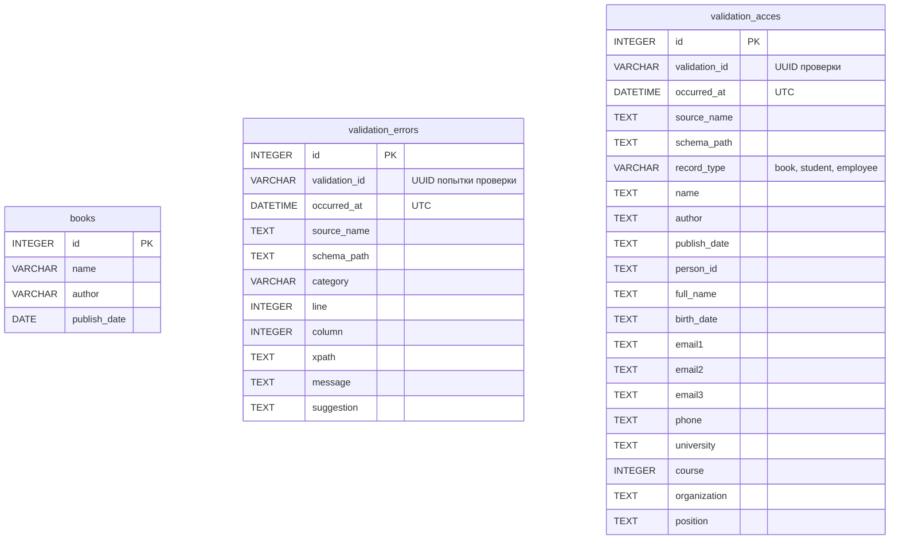

# SQLite: результаты проверки и просмотр в DBeaver

Приложение использует файл `books.db` в корне проекта. Путь вычисляется в `app/db.py`
относительно исходного кода, поэтому запуск из другой папки не создаёт другую БД.

## Что сохраняется

- `books`: данные книг после проверки и явного импорта через `save_books()`.
- `validation_errors`: ошибки синтаксиса XML, запрещённого DOCTYPE и соответствия XSD.
- `validation_acces`: данные книг и людей после успешной проверки, разложенные по столбцам.

Оконный валидатор записывает результат автоматически при открытии, проверке по F5,
перечитывании и проверке после сохранения: ошибки в `validation_errors`, корректные
данные в `validation_acces`. Это же делают `validate_file()` и `validate_xml()`.
Успешная проверка сама по себе не создаёт запись в `books`; нужен вызов импорта.
Успех проверки и количество сохранённых строк пишутся в текстовый лог.

## Структура таблиц



Между таблицами нет внешнего ключа: ошибочный документ может вообще не содержать
книг, а запись Book появляется только после успешного импорта. Поэтому DBeaver
покажет три самостоятельные таблицы без линии связи. `validation_id` тоже не внешний
ключ: он группирует строки одной проверки внутри таблицы ошибок или успешных данных.

## Как устроена validation_acces

Имя таблицы сохранено в написании `validation_acces`. Одна строка - одна книга
или один человек из проверенного XML. Если в документе студент и сотрудник,
сохраняются две строки с общими `validation_id`, временем и именем источника.

| Для каких записей | Столбцы |
| --- | --- |
| Все | id, validation_id, occurred_at, source_name, schema_path, record_type |
| Книга (`book`) | name, author, publish_date |
| Человек | person_id (атрибут XML id), full_name, birth_date, email1, email2, email3, phone |
| Студент (`student`) | Общие поля человека, university, course |
| Сотрудник (`employee`) | Общие поля человека, organization, position |

Для курсовой используется одна общая таблица: неподходящие поля имеют значение NULL.
Например, у книги пустые столбцы university и position. У сотрудника пустой course.
Три email хранятся отдельно, потому что схема People допускает максимум три адреса.
Даты хранятся как XML-текст, чтобы сохранить в том числе часовой пояс, допустимый xs:date.
Полный исходный XML не сохраняется; сохраняются поля, имя файла и путь схемы.

Каждая успешная проверка добавляет строки заново: это история попыток, поэтому F5
для того же документа создаст новую группу. Все строки документа записываются одной
транзакцией. При сбое они откатываются, в лог записывается ошибка, а приложение
сообщает: XML корректен, но данные не записаны в БД. В Python это исключение
`ValidationStorageError`, отличное от ошибки содержимого `XMLValidationError`.

Сохранение по столбцам поддерживает две схемы приложения: Books и People.
Будущая простая кнопка GUI сможет показывать список источников по validation_id,
а затем строки выбранного документа. Сейчас данные можно открыть в DBeaver.

## Как устроена validation_errors

| Поле validation_errors | Назначение |
| --- | --- |
| id | Первичный ключ отдельной ошибки |
| validation_id | UUID попытки проверки, общий для всех её ошибок |
| occurred_at | Время попытки в UTC; хранится без суффикса часового пояса |
| source_name | Полный путь XML, `<редактор>` для нового текста в окне или `<bytes>` для байтов без имени |
| schema_path | Полный путь выбранной XSD |
| category | `Синтаксис XML`, `Формат XML` или `XSD` |
| line, column | Строка и столбец; 0 означает, что точное положение не сообщено |
| xpath | Путь к элементу, если доступен; иначе пустая строка |
| message | Исходная диагностика парсера/XSD |
| suggestion | Подсказка по исправлению |

Все столбцы обязательны. На `validation_id` и `occurred_at` созданы индексы.
Одна ошибка - одна строка. Если ошибок три, в рамках одной транзакции добавятся три
строки с одинаковыми `validation_id` и `occurred_at`. Новый запуск F5 создаёт новую
попытку, даже если текст не менялся. Предыдущие ошибки не удаляются после исправления.
Полный XML не сохраняется, но сообщение ошибки может содержать неверное значение поля.

Ожидаемые ошибки XML пишутся в `log/app_log` с уровнем WARNING, успех - INFO.
При техническом сбое записи в SQLite логгер пишет ERROR со стеком исключения.
Исходная ошибка XML возвращается пользователю, а сбой записи доступен через
`XMLValidationError.persistence_error`. Окно также сообщает, что ошибки не записаны в БД.
В журнале время локальное, в таблице время UTC (для Екатеринбурга прибавьте 5 часов).

Ошибки чтения файла и загрузки XSD не являются нарушениями XML: они не заносятся
в `validation_errors`. Ошибка XSD-конфигурации пишется в лог и возвращается как RuntimeError.
Новые таблицы создаются через `init_db()` или автоматически при соответствующем результате проверки.
Тесты используют отдельную SQLite в памяти.

## Подключение через DBeaver

1. Выберите **Database → New Database Connection** и драйвер **SQLite**.
2. В поле **Path** выберите существующий файл:
   `E:\.MEPHI\4 курс\Ваганов\Project-XML\books.db`.
3. Нажмите **Test Connection**, затем **Finish**. При первом подключении DBeaver
   может предложить загрузить JDBC-драйвер - подтвердите загрузку.
4. Раскройте подключение и узел **Tables**. Откройте `books`, `validation_errors` или `validation_acces`
   двойным щелчком, затем вкладку **Data**. В некоторых версиях есть команда
   **View Data → All Rows** в контекстном меню таблицы.
5. После проверки XML обновите данные таблицы, чтобы увидеть новые строки.

Здесь подключение идёт к файлу: адрес сервера, порт, имя пользователя и пароль
не нужны. В PostgreSQL эти параметры используются для соединения с сервером.
Сам DBeaver в обоих случаях выступает программой для просмотра структуры и данных.

Чтобы построить схему, откройте вкладку **Diagram / ER Diagram** у таблицы или
контейнера таблиц. Для отдельной общей диаграммы: **File → New → DBeaver → ER Diagram**,
затем добавьте таблицы из подключения. Названия пунктов немного зависят от версии.
Типы и столбцы берутся из реальной БД; текст DDL сохранён также в `docs/database-schema.sql`.

## Запросы для SQL Editor

Книги:

```sql
SELECT * FROM books ORDER BY id DESC;
```

Последние успешно проверенные данные:

```sql
SELECT * FROM validation_acces ORDER BY id DESC;
```

Люди в понятном табличном виде:

```sql
SELECT source_name, record_type, full_name, birth_date,
       email1, email2, email3, phone, university, course, organization, position
FROM validation_acces
WHERE record_type IN ('student', 'employee')
ORDER BY id DESC;
```

Список успешно проверенных документов (подготовка для будущего окна GUI):

```sql
SELECT validation_id, occurred_at, source_name, COUNT(*) AS record_count
FROM validation_acces
GROUP BY validation_id, occurred_at, source_name
ORDER BY occurred_at DESC;
```

Последние ошибки, со временем Екатеринбурга для чтения:

```sql
SELECT id, datetime(occurred_at, '+5 hours') AS time_yekaterinburg,
       source_name, category, line, message, suggestion
FROM validation_errors
ORDER BY id DESC
LIMIT 50;
```

Список неуспешных попыток, а не отдельных ошибок:

```sql
SELECT validation_id, occurred_at, source_name, schema_path, COUNT(*) AS error_count
FROM validation_errors
GROUP BY validation_id, occurred_at, source_name, schema_path
ORDER BY occurred_at DESC;
```

Список таблиц и их SQL-описание:

```sql
SELECT name, sql FROM sqlite_master WHERE type = 'table';
PRAGMA table_info(validation_errors);
```

Официальная документация DBeaver:
[подключение SQLite](https://dbeaver.com/docs/dbeaver/Database-driver-SQLite/),
[диаграммы таблиц](https://dbeaver.com/docs/dbeaver/ER-Diagrams/).
